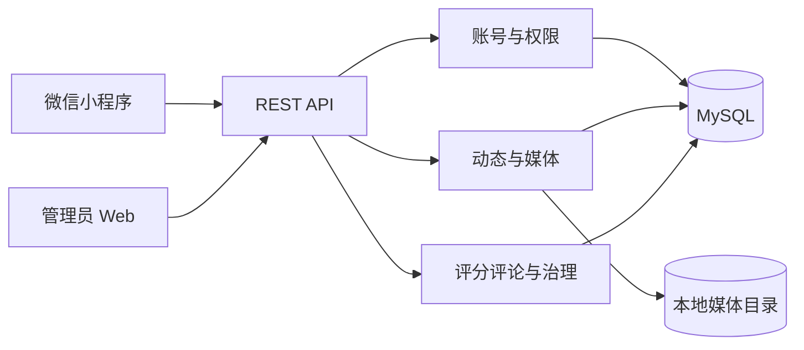
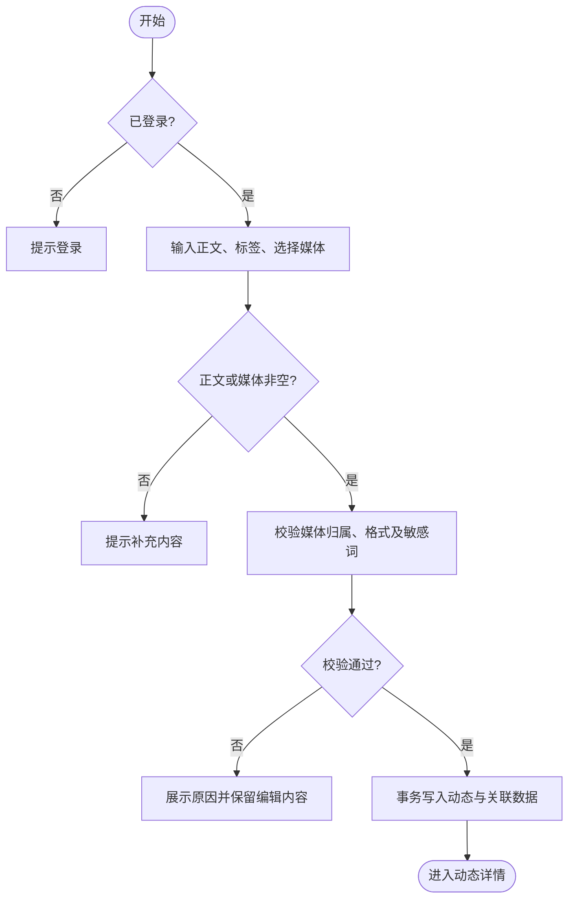
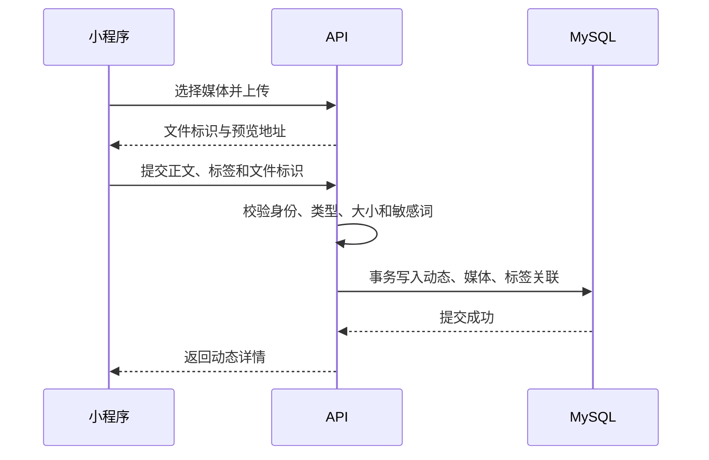

# 系统设计（初稿）

版本：V0.1（2026-11-19）。具体类名、字段类型和组件库在第一周设计评审后冻结。

## 1. 总体结构

两个前端共享一套服务端 API。接口统一使用 `/api/v1` 前缀、JSON 响应和分页参数。服务端按 Controller、Service、Repository 分层，权限在服务端处理。开发环境媒体文件保存在服务端受控目录；如需多人远程部署，集成阶段可替换为对象存储，而不改变业务接口。

## 2. 模块与页面

| 端 | 页面/模块 | 主要交互 |
| --- | --- | --- |
| 小程序 | 登录注册、个人设置 | 登录、退出、修改密码 |
| 小程序 | 首页、检索结果 | 时间倒序、日期区间、标签、多页加载 |
| 小程序 | 发布/编辑、我的动态 | 媒体选择、上传进度、预览、保存、删除 |
| 小程序 | 动态详情 | 媒体播放、评分、评论 |
| 管理 Web | 登录、用户管理 | 查询、禁用/恢复、逻辑删除 |
| 管理 Web | 内容管理 | 组合检索、详情、下架、评论处理 |
| 管理 Web | 统计看板 | 关键数量与近 7 日趋势，显示统计时间和口径 |

## 3. 核心数据实体

| 表 | 核心字段 | 约束 |
| --- | --- | --- |
| `users` | id, username, password_hash, role, status, created_at | username 唯一；role 为 USER/ADMIN |
| `posts` | id, author_id, body, media_type, status, created_at, updated_at | author_id 外键；状态为 PUBLISHED/HIDDEN/DELETED |
| `media` | id, post_id, storage_key, mime_type, size_bytes, sort_order | 路径由服务端生成；不保存客户端原始路径 |
| `tags` | id, name | name 唯一 |
| `post_tags` | post_id, tag_id | 复合唯一键 |
| `ratings` | id, post_id, user_id, score, updated_at | `(post_id, user_id)` 唯一；score 1-5 |
| `comments` | id, post_id, user_id, body, status, created_at | 记录作者和删除状态 |
| `activity_events` | id, user_id, action, occurred_at | 用于日活跃统计；只存必要事件 |
| `admin_actions` | id, admin_id, target_type, target_id, action, created_at | 记录管理操作 |

平均分和评分数可先由 SQL 聚合查询，避免首版维护冗余计数。热门内容不是核心需求，不预先设计推荐服务。

## 4. API 边界（待第一周冻结）

| 业务 | 接口示例 | 访问权限 |
| --- | --- | --- |
| 登录与密码 | `POST /auth/register`, `POST /auth/login`, `PUT /me/password` | 游客/本人 |
| 我的资料 | `GET /me`, `GET /me/posts` | 本人 |
| 动态 | `GET /posts`, `GET /posts/{id}`, `POST /posts`, `PUT /posts/{id}`, `DELETE /posts/{id}` | 公开读取；写入需登录及作者校验 |
| 媒体 | `POST /media/uploads` | 登录用户 |
| 标签 | `GET /tags` | 登录用户 |
| 评分/评论 | `PUT /posts/{id}/rating`, `GET/POST /posts/{id}/comments`, `DELETE /comments/{id}` | 读公开；写入需登录及权限校验 |
| 管理用户 | `GET /admin/users`, `PATCH /admin/users/{id}/status` | 管理员 |
| 管理内容 | `GET /admin/posts`, `PATCH /admin/posts/{id}/status`, `DELETE /admin/comments/{id}` | 管理员 |
| 统计 | `GET /admin/stats/overview`, `GET /admin/stats/daily` | 管理员 |

列表统一返回 `items, page, pageSize, total`。失败统一返回 `code, message, details`，HTTP 状态区分未登录、无权限、参数错误、资源不存在和服务端错误。媒体接口只返回可访问 URL 与文件标识；业务接口不接受任意磁盘路径。

## 5. 核心流程与权限

### 5.1 发布动态的活动路径

结束状态包括要求登录、内容为空、媒体或敏感词校验失败、保存成功；实际实现还需处理数据库失败并返回可重试提示。

### 5.2 主要领域类（设计草图）

| 类/服务 | 关键属性或依赖 | 主要方法 | 约束 |
| --- | --- | --- | --- |
| `User` | id、username、passwordHash、role、status | `changePassword()`、`disable()` | 不暴露密码哈希到前端 |
| `Post` | id、authorId、body、mediaType、status | `update()`、`hide()`、`delete()` | 只有作者可编辑，管理员可下架 |
| `PostService` | PostRepository、MediaService、TagRepository | `create()`、`update()`、`search()` | 统一执行权限与事务校验 |
| `InteractionService` | RatingRepository、CommentRepository | `upsertRating()`、`addComment()`、`deleteComment()` | 同一用户每条动态一条评分 |
| `ModerationService` | 词库、AdminActionRepository | `checkText()`、`hidePost()` | 命中敏感词拦截，管理操作留痕 |

这里记录职责与关系；类的完整属性、方法参数、返回值和异常将在实现前的详细设计中补齐。

### 5.3 发布动态的时序

发布与编辑需要校验媒体归属，防止引用其他用户的上传文件。删除、编辑、评分、评论和后台管理操作都以服务端权限校验为准。禁用用户的令牌在服务端鉴权时失效。密码采用 BCrypt 等成熟哈希算法，不记录明文。

## 6. 开发与演示环境

开发人员分别运行小程序开发工具、Vite 管理端和 Spring Boot API，共用约定的本地 MySQL 初始化脚本。仓库只存配置示例，不存真实密码或上传文件。演示环境使用独立测试账号与可公开展示的样例图片/短视频；演示前固定数据并准备数据库重置脚本。

部署视图：开发机上小程序由微信开发者工具运行，浏览器访问 Vite 管理页面，两者经 HTTP(S) 连接 Spring Boot 服务进程；服务进程访问 MySQL 和本地媒体目录。演示若跨设备访问，API、数据库与媒体目录放在同一台受控演示机，小程序和浏览器经局域网连接；正式小程序真机访问还需满足微信域名与 HTTPS 配置。

## 7. 待评审的技术决策

- uni-app 的具体版本和微信开发者工具配置。
- 用户名/邮箱/微信授权中的注册方式。
- 媒体格式、数量、大小限制与开发/演示存储方式。
- 是否开放游客浏览，以及逻辑删除后的管理可见性。

上述决策须在第一周结束前定稿，并同步 API 契约和测试用例。
