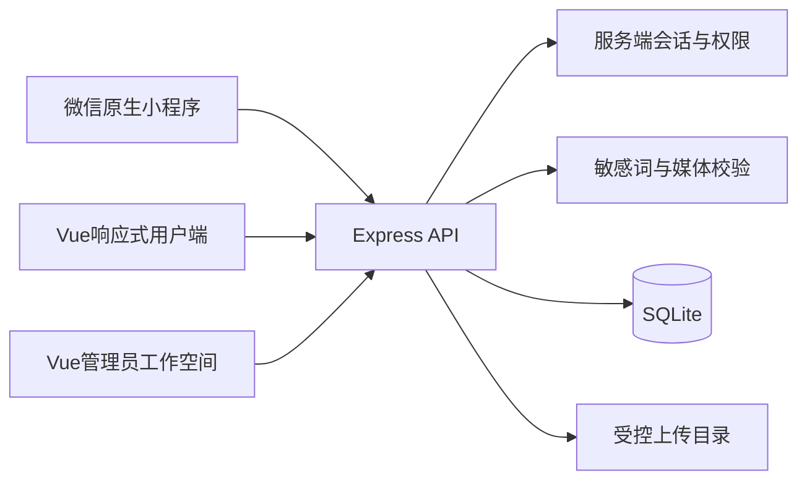

# 片刻 · 产品与技术设计

## 设计目标

用“主题带动记录，时间与标签组织回忆”建立场景。首页不是空白的发帖列表：先给出本期创作题，再展示独立的文字/影像卡片。用户的个人记录单独收纳，后台以数据、内容、用户、操作记录四个工作区组织。

不使用真实姓名、手机号、精确位置作为注册前提；游客可以浏览，写入需要登录。评分用于内容反馈，不引入排行榜和强竞争。

## 课程要求对照

| 要求 | 实现入口 | 关键验收 |
| --- | --- | --- |
| 小程序图片、视频、文本 | 记录页，`POST /media`、`POST /posts` | 上传真实文件；不能借用他人的媒体；允许纯文字 |
| 自己内容查看修改删除 | 我的回忆 | 作者验证在服务端，不能靠隐藏按钮控制 |
| 标签、日期等检索 | 发现页 | 标签精确匹配，日期按北京时间自然日；支持关键词 |
| 他人评分 | 详情页 | 1-5整数，禁止自评，同用户重复提交更新 |
| 评论 | 详情页 | 内容校验，自己和管理员可删除评论 |
| 设置登录密码 | 注册、账号设置 | 哈希存储；改密撤销所有会话 |
| 管理所有上传内容 | 管理工作台 / 内容管理 | 查询、下架、恢复、逻辑删除及操作留痕 |
| 管理用户 | 管理工作台 / 用户管理 | 账号昵称查询，禁用/恢复/删除，不允许修改管理员 |
| 加分：敏感词 | 可配置词库，服务端统一检查 | 发布编辑评论均生效，命中不写业务数据 |
| 加分：统计分析图 | 数据概览 | 7日新增用户、新增内容、DAU柱图及热门标签 |
| 特色：主题征集 | 首页和发布表单 | 内容关联主题，可按主题检索 |

好友、AI、视频转码不属于当前实现，不以假入口或模拟响应充数。

## 信息架构

实体：users / sessions / posts / media / topics / ratings / comments / events / audit。唯一索引保证账号唯一和同人同内容评分唯一；内容保存和媒体绑定在事务内完成。SQL 参数绑定，不拼接用户提供的 SQL。

角色：游客只读公开内容；普通用户写自己的内容、评分他人内容、写删自己评论；管理员读取和治理内容及账号、删评论、查统计。管理员不修改别人的正文。

## 状态与权限

- 用户 ACTIVE / DISABLED / DELETED。后两者不能认证，关联内容不公开。管理员不可被此管理接口修改。
- 内容 PUBLISHED / HIDDEN / DELETED。公开列表、详情和上传媒体只展示 PUBLISHED 且作者ACTIVE的数据。作者可删自己的下架内容，但不能编辑下架内容以规避治理。
- 评论 ACTIVE / DELETED，读取排除已删除，记录仍保留用于追溯。
- 公共上传前，只有上传者凭有效会话可访问文件；绑定公开内容后才公开；删除或下架后旧链接失效。

## 统计口径

按北京时间自然日，近7日含今天。累计普通用户包含后来禁用/删除账号，累计内容包含后来下架/删除记录。DAU为成功登录、首次发布、评论、评分的普通用户按user_id去重；管理员活动不计，事件统计不采集IP或正文。单次请求生成 asOf 时间，今日未结束，事件与业务不是可靠消息事务，不承诺审计级无丢失统计。

## 交互与反馈

前端呈现加载、空、失败重试和正常四态。上传中与提交中禁用重复提交，敏感词、越权及参数失败保留表单内容。删除/下架有确认，成功后刷新数据。移动布局底部导航，桌面侧边导航。所有图标按钮有可访问名称，原生表单标签对应输入。

## 交付边界

这是可运行的本地课程实现，使用真实持久化接口；不是生产级社交平台。图片做签名字节和大小检查，视频做MP4容器签名和大小检查，未做完整解码、安全扫描和转码；公网运营需额外的内容审核、资源配额、TLS、备份、监控和部署验收。
